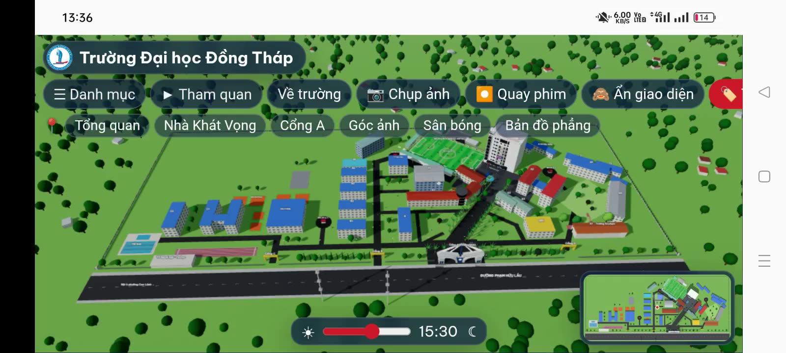

# F000001 — 00:00.000

## Trích xuất

- Số thứ tự: 1/933, đánh số từ 1.
- Timestamp PTS gốc: `0.000000` giây; key frame codec: 1; loại codec picture: I.
- Ảnh: 1600×720, JPEG q=4, áp rotation nguồn, không crop.
- SHA-256: `606f2514713ee2a5b656801ee39c9a77f0a0522a1bf68ba15cf42a5eef17077e`.
- Khoảng PTS so với frame trước: Không có frame trước.
- Thay đổi ảnh crop world so với frame trước (MAD RGB): Không có frame trước; mean luma crop: 115.632.

## Nội dung và bối cảnh

**S01 — Tổng quan khuôn viên**. Bản đồ toàn trường với HUD ba tầng, minimap và thanh giờ 15:30. Không có panel POI trong đoạn đầu.

Frame này đã được mở ở độ phân giải gốc để đối chiếu trực tiếp.

## Vấn đề cần đối chiếu và hướng sửa

[O01](../issues/O01.md) · [O02](../issues/O02.md) · [O14](../issues/O14.md) · [O12](../issues/O12.md)

Các issue dùng **chính frame này** làm mốc dẫn chứng: O01, O02, O12, O13, O14, V04, V05, V06, V07, V08, V09, V12. Trường related_issue_ids là danh sách việc liên quan để kiểm tra, không chứng minh tất cả lỗi cùng xảy ra ở đúng pixel của hình này.

Đối với thao tác camera ở đây, ảnh đơn không xác nhận người dùng đã nhấn nút nào, pathfinding chạy hay input bị lỗi. Trước khi sửa, so sánh frame trước/sau, đọc issuecard, tái hiện runtime và dùng log mode/input nếu cần.

## Chỉ dẫn cho Claude

Tập trung O01, O02, O12, O14; mở tiêu chí nghiệm thu trong issuecards, chọn module thật trong repo. Không dùng khoảng PTS/thay đổi ảnh để gán FPS runtime hoặc kết luận giật do GPU. Không viết patch chỉ từ mô tả phân đoạn khi chưa đối chiếu hình.

[Sau](frame_000002.md) · [Chỉ mục](../FRAME_ANALYSIS.md) · [Claude](../CLAUDE_START_HERE.md)
