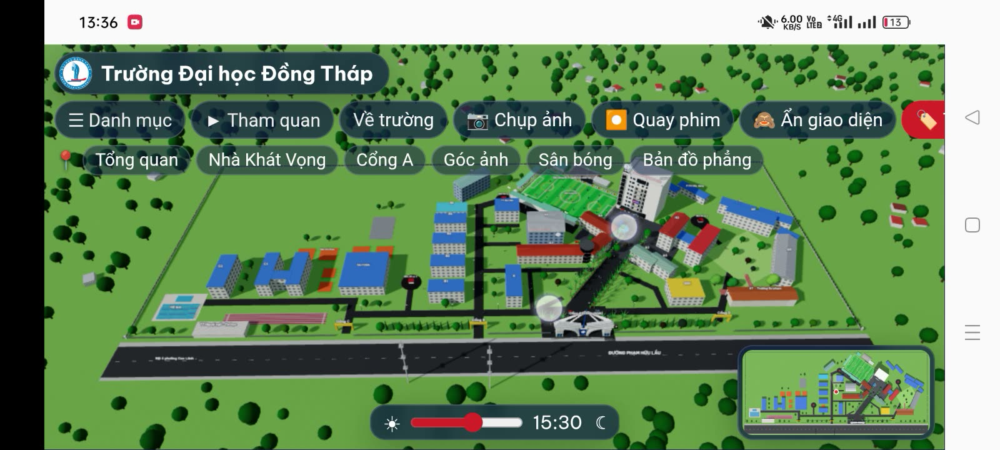

# F000055 — 00:02.987

## Trích xuất

- Số thứ tự: 55/933, đánh số từ 1.
- Timestamp PTS gốc: `2.987433` giây; key frame codec: 0; loại codec picture: P.
- Ảnh: 1600×720, JPEG q=4, áp rotation nguồn, không crop.
- SHA-256: `b96141d8d9999f8c0e9a8410ceae012dfa7d3f6b8f0c63901a2d5eb5646afaf8`.
- Khoảng PTS so với frame trước: 19.566 ms.
- Thay đổi ảnh crop world so với frame trước (MAD RGB): 0.2815; mean luma crop: 116.441.

## Nội dung và bối cảnh

**S01 — Tổng quan khuôn viên**. Bản đồ toàn trường với HUD ba tầng, minimap và thanh giờ 15:30. Không có panel POI trong đoạn đầu.

Ghi chú cho frame này dùng bối cảnh phân đoạn và số đo tự động; không coi là một kết luận thủ công mới độc lập.

## Vấn đề cần đối chiếu và hướng sửa

[O01](../issues/O01.md) · [O02](../issues/O02.md) · [O14](../issues/O14.md) · [O12](../issues/O12.md)

Các issue dùng **chính frame này** làm mốc dẫn chứng: Không có issuecard đặt frame này làm mốc riêng; xem mốc đại diện trong cùng đoạn.. Trường related_issue_ids là danh sách việc liên quan để kiểm tra, không chứng minh tất cả lỗi cùng xảy ra ở đúng pixel của hình này.

Đối với thao tác camera ở đây, ảnh đơn không xác nhận người dùng đã nhấn nút nào, pathfinding chạy hay input bị lỗi. Trước khi sửa, so sánh frame trước/sau, đọc issuecard, tái hiện runtime và dùng log mode/input nếu cần.

## Chỉ dẫn cho Claude

Tập trung O01, O02, O12, O14; mở tiêu chí nghiệm thu trong issuecards, chọn module thật trong repo. Không dùng khoảng PTS/thay đổi ảnh để gán FPS runtime hoặc kết luận giật do GPU. Không viết patch chỉ từ mô tả phân đoạn khi chưa đối chiếu hình.

[Trước](frame_000054.md) · [Sau](frame_000056.md) · [Chỉ mục](../FRAME_ANALYSIS.md) · [Claude](../CLAUDE_START_HERE.md)
