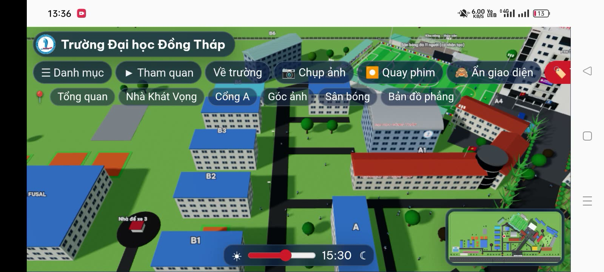

# F000184 — 00:05.678

## Trích xuất

- Số thứ tự: 184/933, đánh số từ 1.
- Timestamp PTS gốc: `5.677878` giây; key frame codec: 0; loại codec picture: P.
- Ảnh: 1600×720, JPEG q=4, áp rotation nguồn, không crop.
- SHA-256: `5c1467ff5dc1ed5670afe47edb1ccc42a05c52fbba5e56b97eac4584f9eaaeac`.
- Khoảng PTS so với frame trước: 20.311 ms.
- Thay đổi ảnh crop world so với frame trước (MAD RGB): 0.3763; mean luma crop: 111.056.

## Nội dung và bối cảnh

**S02 — Quan sát gần hơn khối nhà trung tâm**. Góc nhìn tiến gần các dãy nhà, sân và đường nội bộ. Chỉ từ bản ghi không xác định gesture hay nút đã tạo chuyển động.

Ghi chú cho frame này dùng bối cảnh phân đoạn và số đo tự động; không coi là một kết luận thủ công mới độc lập.

## Vấn đề cần đối chiếu và hướng sửa

[O01](../issues/O01.md) · [O02](../issues/O02.md) · [O14](../issues/O14.md) · [O11](../issues/O11.md) · [O15](../issues/O15.md) · [O16](../issues/O16.md)

Các issue dùng **chính frame này** làm mốc dẫn chứng: Không có issuecard đặt frame này làm mốc riêng; xem mốc đại diện trong cùng đoạn.. Trường related_issue_ids là danh sách việc liên quan để kiểm tra, không chứng minh tất cả lỗi cùng xảy ra ở đúng pixel của hình này.

Đối với thao tác camera ở đây, ảnh đơn không xác nhận người dùng đã nhấn nút nào, pathfinding chạy hay input bị lỗi. Trước khi sửa, so sánh frame trước/sau, đọc issuecard, tái hiện runtime và dùng log mode/input nếu cần.

## Chỉ dẫn cho Claude

Tập trung O01, O02, O11, O15, O16; mở tiêu chí nghiệm thu trong issuecards, chọn module thật trong repo. Không dùng khoảng PTS/thay đổi ảnh để gán FPS runtime hoặc kết luận giật do GPU. Không viết patch chỉ từ mô tả phân đoạn khi chưa đối chiếu hình.

[Trước](frame_000183.md) · [Sau](frame_000185.md) · [Chỉ mục](../FRAME_ANALYSIS.md) · [Claude](../CLAUDE_START_HERE.md)
