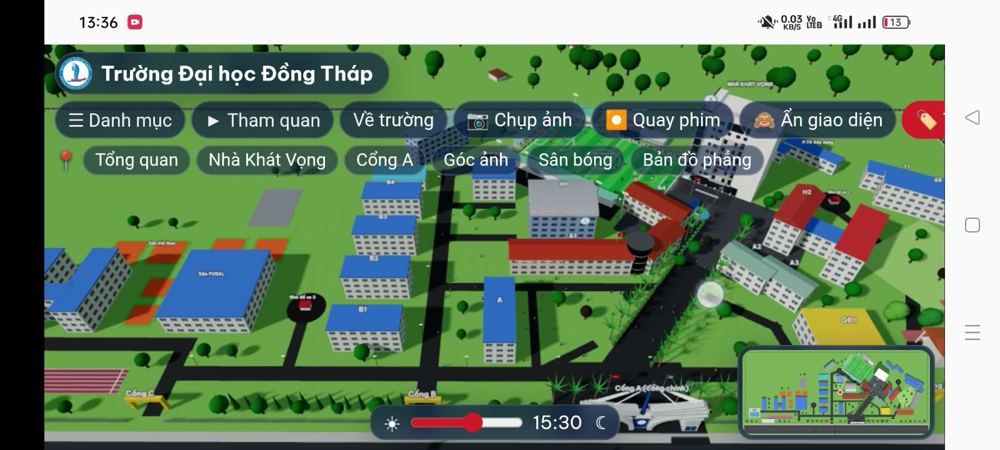

# F000391 — 00:12.330

## Trích xuất

- Số thứ tự: 391/933, đánh số từ 1.
- Timestamp PTS gốc: `12.329989` giây; key frame codec: 1; loại codec picture: I.
- Ảnh: 1600×720, JPEG q=4, áp rotation nguồn, không crop.
- SHA-256: `69422c3d11ea2bb538ea83a3fb63d17c1bd0e91eb0e244c748ad413b18dba7d1`.
- Khoảng PTS so với frame trước: 17.789 ms.
- Thay đổi ảnh crop world so với frame trước (MAD RGB): 21.9598; mean luma crop: 109.696.

## Nội dung và bối cảnh

**S03 — Cận cảnh nhóm A/B và khu thể thao**. Các nhãn mã nhà và mái màu hiện rõ hơn; HUD tiếp tục chiếm dải trên.

Ghi chú cho frame này dùng bối cảnh phân đoạn và số đo tự động; không coi là một kết luận thủ công mới độc lập.

## Vấn đề cần đối chiếu và hướng sửa

[O01](../issues/O01.md) · [O02](../issues/O02.md) · [O14](../issues/O14.md) · [O06](../issues/O06.md) · [O11](../issues/O11.md) · [O16](../issues/O16.md)

Các issue dùng **chính frame này** làm mốc dẫn chứng: Không có issuecard đặt frame này làm mốc riêng; xem mốc đại diện trong cùng đoạn.. Trường related_issue_ids là danh sách việc liên quan để kiểm tra, không chứng minh tất cả lỗi cùng xảy ra ở đúng pixel của hình này.

Đối với thao tác camera ở đây, ảnh đơn không xác nhận người dùng đã nhấn nút nào, pathfinding chạy hay input bị lỗi. Trước khi sửa, so sánh frame trước/sau, đọc issuecard, tái hiện runtime và dùng log mode/input nếu cần.

## Chỉ dẫn cho Claude

Tập trung O01, O06, O11, O16; mở tiêu chí nghiệm thu trong issuecards, chọn module thật trong repo. Không dùng khoảng PTS/thay đổi ảnh để gán FPS runtime hoặc kết luận giật do GPU. Không viết patch chỉ từ mô tả phân đoạn khi chưa đối chiếu hình.

[Trước](frame_000390.md) · [Sau](frame_000392.md) · [Chỉ mục](../FRAME_ANALYSIS.md) · [Claude](../CLAUDE_START_HERE.md)
