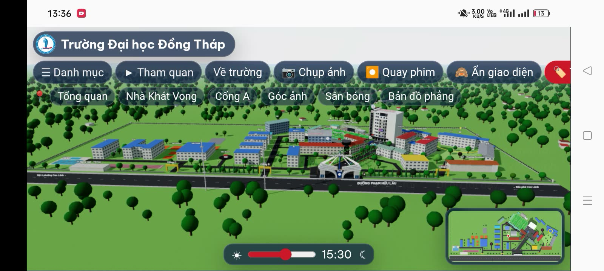

# F000681 — 00:19.975

## Trích xuất

- Số thứ tự: 681/933, đánh số từ 1.
- Timestamp PTS gốc: `19.975144` giây; key frame codec: 0; loại codec picture: P.
- Ảnh: 1600×720, JPEG q=4, áp rotation nguồn, không crop.
- SHA-256: `f17e0774d7b113ed04370647cdd5f245e1f7645a53bc3df7c16af123f8bcd291`.
- Khoảng PTS so với frame trước: 23.288 ms.
- Thay đổi ảnh crop world so với frame trước (MAD RGB): 0.0; mean luma crop: 114.566.

## Nội dung và bối cảnh

**S05 — Chuyển xuống góc thấp**. Góc nhìn chuyển gần mặt đất; ở mốc kế tiếp panel A8 xuất hiện. Nguyên nhân chuyển góc chưa xác định.

Ghi chú cho frame này dùng bối cảnh phân đoạn và số đo tự động; không coi là một kết luận thủ công mới độc lập.

## Vấn đề cần đối chiếu và hướng sửa

[O01](../issues/O01.md) · [O02](../issues/O02.md) · [O14](../issues/O14.md) · [O10](../issues/O10.md) · [O13](../issues/O13.md)

Các issue dùng **chính frame này** làm mốc dẫn chứng: Không có issuecard đặt frame này làm mốc riêng; xem mốc đại diện trong cùng đoạn.. Trường related_issue_ids là danh sách việc liên quan để kiểm tra, không chứng minh tất cả lỗi cùng xảy ra ở đúng pixel của hình này.

Đối với thao tác camera ở đây, ảnh đơn không xác nhận người dùng đã nhấn nút nào, pathfinding chạy hay input bị lỗi. Trước khi sửa, so sánh frame trước/sau, đọc issuecard, tái hiện runtime và dùng log mode/input nếu cần.

## Chỉ dẫn cho Claude

Tập trung O10, O13; mở tiêu chí nghiệm thu trong issuecards, chọn module thật trong repo. Không dùng khoảng PTS/thay đổi ảnh để gán FPS runtime hoặc kết luận giật do GPU. Không viết patch chỉ từ mô tả phân đoạn khi chưa đối chiếu hình.

[Trước](frame_000680.md) · [Sau](frame_000682.md) · [Chỉ mục](../FRAME_ANALYSIS.md) · [Claude](../CLAUDE_START_HERE.md)
