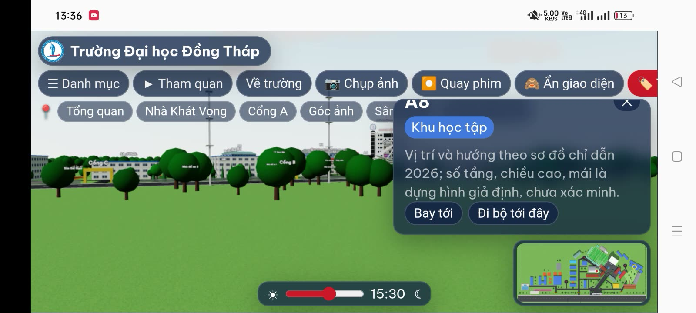

# F000693 — 00:20.985

## Trích xuất

- Số thứ tự: 693/933, đánh số từ 1.
- Timestamp PTS gốc: `20.985422` giây; key frame codec: 0; loại codec picture: P.
- Ảnh: 1600×720, JPEG q=4, áp rotation nguồn, không crop.
- SHA-256: `1e9b56b7b6f7bc85e7194e2df215e47567060a3f119c22b15a8618c8a9dc709b`.
- Khoảng PTS so với frame trước: 98.789 ms.
- Thay đổi ảnh crop world so với frame trước (MAD RGB): 0.0504; mean luma crop: 144.267.

## Nội dung và bối cảnh

**S06 — Góc thấp có cây tiền cảnh và panel A8**. Panel A8 với tiêu đề cắt, mô tả về giả định hình học, hai nút Bay tới/Đi bộ tới đây. Cây và nhãn ở hậu cảnh cần đối chiếu occlusion.

Frame này đã được mở ở độ phân giải gốc để đối chiếu trực tiếp.

## Vấn đề cần đối chiếu và hướng sửa

[O01](../issues/O01.md) · [O02](../issues/O02.md) · [O14](../issues/O14.md) · [O03](../issues/O03.md) · [O04](../issues/O04.md) · [O05](../issues/O05.md) · [O07](../issues/O07.md) · [O09](../issues/O09.md) · [O13](../issues/O13.md) · [O17](../issues/O17.md)

Các issue dùng **chính frame này** làm mốc dẫn chứng: O01, O03, O04, O05, O07, O12, O13, O14, O17, V03, V05, V11, V12. Trường related_issue_ids là danh sách việc liên quan để kiểm tra, không chứng minh tất cả lỗi cùng xảy ra ở đúng pixel của hình này.

Đối với thao tác camera ở đây, ảnh đơn không xác nhận người dùng đã nhấn nút nào, pathfinding chạy hay input bị lỗi. Trước khi sửa, so sánh frame trước/sau, đọc issuecard, tái hiện runtime và dùng log mode/input nếu cần.

## Chỉ dẫn cho Claude

Tập trung O03, O04, O05, O07, O09, O13, O17; mở tiêu chí nghiệm thu trong issuecards, chọn module thật trong repo. Không dùng khoảng PTS/thay đổi ảnh để gán FPS runtime hoặc kết luận giật do GPU. Không viết patch chỉ từ mô tả phân đoạn khi chưa đối chiếu hình.

[Trước](frame_000692.md) · [Sau](frame_000694.md) · [Chỉ mục](../FRAME_ANALYSIS.md) · [Claude](../CLAUDE_START_HERE.md)
