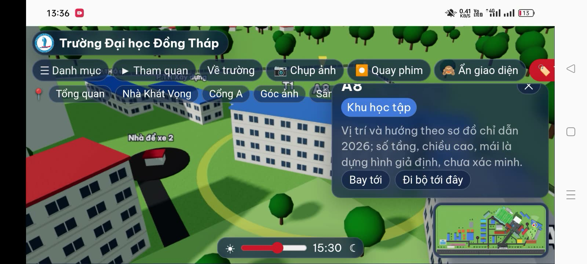

# F000822 — 00:27.005

## Trích xuất

- Số thứ tự: 822/933, đánh số từ 1.
- Timestamp PTS gốc: `27.005133` giây; key frame codec: 0; loại codec picture: P.
- Ảnh: 1600×720, JPEG q=4, áp rotation nguồn, không crop.
- SHA-256: `7fa521cd3d518a0f55a124784074b23381996cdfffce06ef6f7876cc57883398`.
- Khoảng PTS so với frame trước: 15.800 ms.
- Thay đổi ảnh crop world so với frame trước (MAD RGB): 12.1342; mean luma crop: 107.605.

## Nội dung và bối cảnh

**S11 — Góc cao quanh A8 và dấu chọn**. Quan sát dãy mái xanh, nhãn A8 và vòng vàng dưới đất; ý nghĩa dấu chọn trên minimap cần chú giải.

Frame này đã được mở ở độ phân giải gốc để đối chiếu trực tiếp.

## Vấn đề cần đối chiếu và hướng sửa

[O01](../issues/O01.md) · [O02](../issues/O02.md) · [O14](../issues/O14.md) · [O03](../issues/O03.md) · [O04](../issues/O04.md) · [O07](../issues/O07.md) · [O12](../issues/O12.md) · [O13](../issues/O13.md) · [O16](../issues/O16.md)

Các issue dùng **chính frame này** làm mốc dẫn chứng: O12. Trường related_issue_ids là danh sách việc liên quan để kiểm tra, không chứng minh tất cả lỗi cùng xảy ra ở đúng pixel của hình này.

Đối với thao tác camera ở đây, ảnh đơn không xác nhận người dùng đã nhấn nút nào, pathfinding chạy hay input bị lỗi. Trước khi sửa, so sánh frame trước/sau, đọc issuecard, tái hiện runtime và dùng log mode/input nếu cần.

## Chỉ dẫn cho Claude

Tập trung O03, O04, O07, O12, O13, O16; mở tiêu chí nghiệm thu trong issuecards, chọn module thật trong repo. Không dùng khoảng PTS/thay đổi ảnh để gán FPS runtime hoặc kết luận giật do GPU. Không viết patch chỉ từ mô tả phân đoạn khi chưa đối chiếu hình.

[Trước](frame_000821.md) · [Sau](frame_000823.md) · [Chỉ mục](../FRAME_ANALYSIS.md) · [Claude](../CLAUDE_START_HERE.md)
